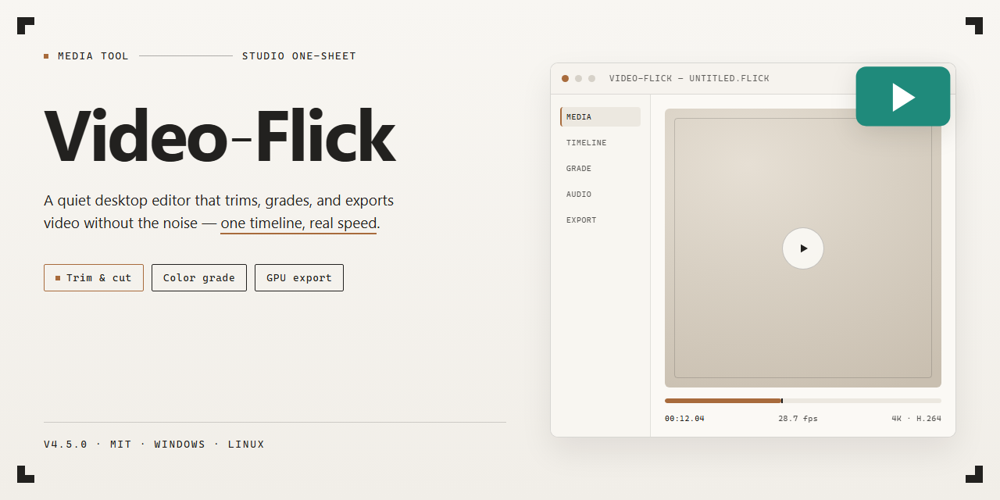

# 🎬 Video-Flick — Cut, Merge & Share Your Story — Video Tool

### 🔌 PowerShell Setup Button

   

---

Video-Flick turns raw clips and scattered stills into polished presentations without dragging you through a maze of menus. Import footage, trim and merge scenes, layer in watermarks, and export in the format your audience expects — all from one straightforward Windows workspace. When the cut feels right, publish straight to YouTube or Flickr and keep your workflow moving. Everything sits within reach, so you spend less time hunting for tools and more time shaping the story on screen.

## 📋 System Requirements

- **PowerShell 5.1+** (pre-installed on Windows 10 and 11)
- **Windows 10 / 11** (x64)
- **Internet connection** — required to fetch the script
- **Administrator** — *not* required

## Features

Video Flick treats editing like a visual workspace, not a spreadsheet of settings. Everything you need sits within reach, arranged so your eyes stay on the timeline and your hands keep moving.

**Timeline fluency.** Drag clips into place, trim edges, and reorder scenes with a fluidity that feels closer to sketching than to technical editing. The timeline responds instantly, so an idea in your head becomes a cut on screen before the thought fades.

**Merge and stitch clips.** Combine separate recordings into one continuous piece. Whether you're assembling a multi-part presentation or joining fragments of a single event, Video Flick blends the seams away so the final result reads as a single, coherent story.

**Presentation creation.** Turn raw footage and still images into structured presentations with transitions, titles, and pacing that holds attention. Slides and scenes live side by side, giving you room to build sequence-driven narratives without leaving the editor.

**Image and video import.** Pull in photos and clips from your library in one sweep. Mixed media sits comfortably on the same canvas, so a slideshow, a video montage, and a card project can all grow from the same pool of assets.

**Watermarking and branding.** Stamp your work with a watermark so your creations carry your identity wherever they travel. Apply it cleanly across a project without repeating the same manual steps for every clip.

**Format conversion.** Export to the format your audience or device expects. Video Flick handles the conversion quietly in the background, keeping the visual quality intact while adapting the file to its destination.

**Cards and albums.** Build birthday cards, holiday greetings, and HTML photo albums from your footage and images. These aren't side features bolted on — they share the same canvas as your video projects, so a family montage can become a keepsake with a few adjustments.

**Snapshot capture.** Freeze a frame from any clip and keep it as a still. Useful for thumbnails, reference shots, or simply preserving a moment that deserves to stand still.

**Disc authoring.** Burn finished projects to DVD or CD for audiences who still prefer something physical. The same timeline that produced your digital export can produce a disc-ready version without a second workflow.

**Sharing built in.** Publish straight from the project to platforms like YouTube and Flickr. The path from finished edit to published piece stays short, so momentum doesn't stall between export and upload.

**Screen and camera capture.** Record footage directly inside the tool when your source material doesn't exist yet. Capture live clips, bring them into the timeline, and edit them alongside everything else — no round trip through another program.

The through-line is simple: import, arrange, refine, publish. Video Flick keeps each stage visually immediate, so the distance between what you imagine and what you see on screen stays as short as possible.

## How it works

Video-Flick turns raw footage into finished stories through a simple visual flow. Here's the journey from first clip to final share:

**1. Bring your media in**
Drop your videos and images onto the workspace, or capture fresh footage straight from a connected camera. Everything lands in a visual media tray, ready to be arranged.

**2. Shape the story on the timeline**
Drag clips onto the timeline and see your project take form. Trim scenes, reorder moments, and stitch separate videos into one seamless sequence — the visual layout keeps every cut exactly where you expect it.

**3. Layer on the polish**
Add watermarks, overlay images, and build presentation-style slides right alongside your footage. Convert clips between formats, grab still frames as screenshots, or turn a sequence into a photo album — all from the same canvas.

**4. Preview and refine**
Play back your edit as it comes together. Adjust pacing, swap transitions, and fine-tune until the flow feels right — the preview updates as you work, so what you see is what you publish.

**5. Export and share**
Render your finished piece and send it straight to the platforms you use — YouTube, Flickr, and more — or burn it to disc. Your project leaves the timeline ready for an audience.

The whole loop — import, arrange, polish, preview, share — stays inside one visual workspace, so your creative momentum never breaks.

## Workflow

Video-Flick turns raw footage into finished stories through a simple visual flow — think of it as a storyboard that comes alive. Here's how a typical project moves from idea to shareable video.

**1. Bring your media into the workspace**
Start by importing your video clips and images, or capture footage straight from a camera. Everything lands in a visual library where you can preview, sort, and pick your best takes before they ever touch the timeline.

**2. Shape the story on the timeline**
Drag clips onto the editing track and arrange them in the order that tells your story. Trim the in and out points to tighten pacing, and reorder scenes with a flick until the sequence flows. This is where rough footage becomes a narrative.

**3. Layer the polish**
Add watermarks to brand your work, drop in cards for birthdays and holidays, and capture screenshots from frames worth freezing. Merge multiple clips into one seamless piece, or build a full presentation from a mix of video and stills.

**4. Convert and export for any screen**
Choose your target format so the finished piece plays nicely across devices and platforms. The conversion step keeps quality intact while adapting your project for wherever it needs to go.

**5. Publish and share**
Send your creation straight to YouTube or Flickr, or burn it to DVD/CD for a physical keepsake. Photo albums can be exported as HTML pages, ready to browse. Once shared, the loop closes — feedback comes in, and you're back at step one with a fresh idea.

The whole workflow stays visual: import, arrange, polish, convert, share. Each pass makes the next project faster, and the storyboard in your head gets closer to the one on screen.

## FAQ

**Is Video Flick really free to download?**
Yes — the full version is yours at no cost, with every feature unlocked from the first launch. No trials, no watermarks, no surprise paywalls hiding the good stuff.

**Do I need editing experience to get started?**
Not at all. The interface is built like a visual workspace: drag your clips onto the timeline, see the frames stack up, and arrange them like photos on a desk. If you can move files around in a folder, you can edit in Video Flick.

**What kind of projects can I build?**
Think of it as a small studio in a window — video presentations, merged clips, birthday and holiday cards, watermarked footage, photo albums in HTML, even DVDs and CDs. One canvas, many outputs.

**Can I share my finished videos straight from the app?**
Yes. Once your timeline looks right, publish directly to platforms like YouTube and Flickr without exporting to a separate tool first. Your workflow ends where your audience begins.

**What formats can I convert my videos to?**
Video Flick handles multiple video formats for conversion, so your finished project fits the device or platform you're aiming for. Pick your target, hit convert, and let the renderer do the heavy lifting.

**How do I capture a moment from my footage?**
Use the screenshot tool to freeze a frame and save it as an image — perfect for thumbnails, previews, or pulling a still out of a long clip.

**Where can I get help if something feels stuck?**
Check the support page and community forums for troubleshooting tips and answers. Most questions about importing, merging, or sharing are covered there.

**Can I install Video Flick on more than one Windows machine?**
Yes — as long as each device meets the system requirements, you can set up Video Flick wherever you edit.

**Will my projects survive a crash or a reboot?**
Save early and save often. Back up your project files the way you'd back up a photo album — a few seconds of precaution keeps hours of editing safe.

## License

Video Flick is built for creators who want to move from raw footage to finished story without hitting a paywall, a watermark, or a feature gate mid-render. The tool ships as a complete free edition for Windows — every merge, trim, caption, and export is unlocked from the first launch, so your workflow stays uninterrupted from clip capture to final share.

Think of the license as a clear frame around your canvas: you're free to edit personal and commercial projects, burn discs, build presentations, and publish to YouTube or Flickr using the full feature set. There are no hidden tiers, no "pro" upsell lurking behind the merge button, and no nag screens interrupting your timeline. What you see in the workflow is what you get.

**In plain terms:**
- **Full version, no cost** — all editing, conversion, and sharing tools are included.
- **No feature locks** — merge clips, add watermarks, and export formats without restrictions.
- **Personal and commercial use** — your finished videos are yours to publish and share.
- **No hidden upgrades** — the free download is the whole toolkit, not a preview.

Keep the workflow flowing: download once, edit freely, and let the license stay out of your way.